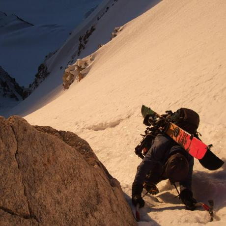
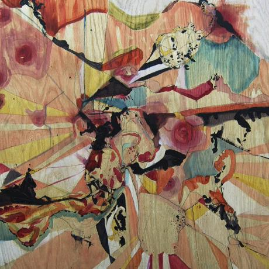
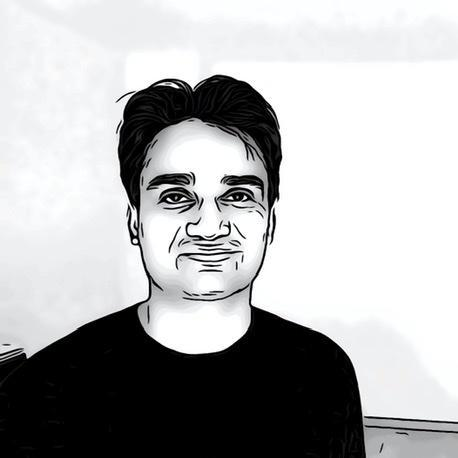
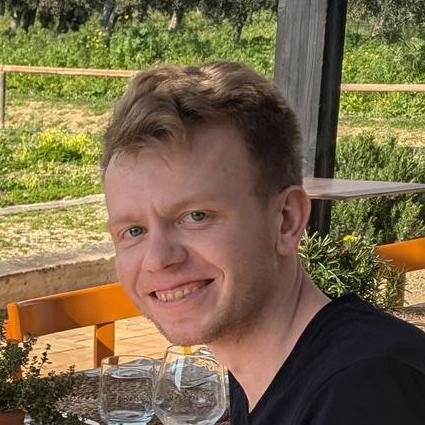
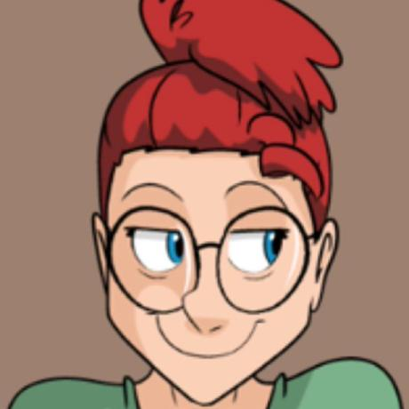
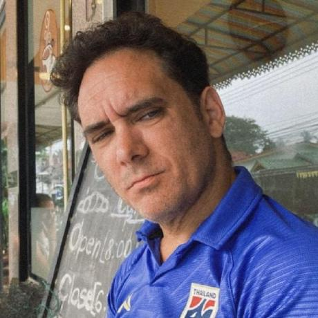
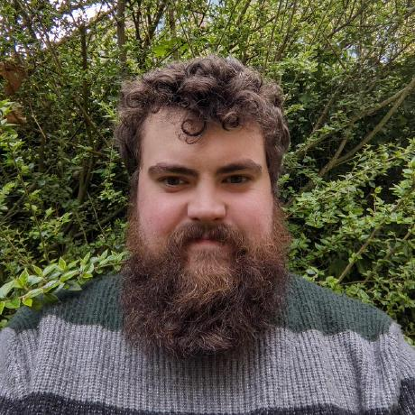
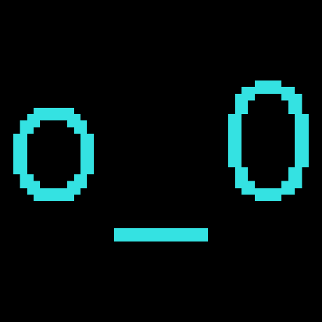

## Team { .toc-only }

We are one team, with a co-lead for each layer. Most of us work mainly on the execution layer (Specs [EL]) or the consensus layer (Specs [CL]), but our work increasingly crosses between them.

### Co-leads

- { .team-avatar }

    #### **Mario Vega**

    Co-lead · EL

    Protocol tester and co-lead with an execution-layer focus.

    [:fontawesome-brands-github:](https://github.com/marioevz){ .md-button target="_blank" }
    [:fontawesome-brands-x-twitter:](https://x.com/elbuenmayini){ .md-button target="_blank" }

- { .team-avatar }

    #### **Justin Traglia**

    Co-lead · CL

    Protocol researcher and co-lead with a consensus-layer focus. Maintains the consensus specs and c-kzg-4844.

    [:fontawesome-brands-github:](https://github.com/jtraglia){ .md-button target="_blank" }
    [:fontawesome-brands-x-twitter:](https://x.com/jtraglia){ .md-button target="_blank" }

### Specs [EL]

- { .team-avatar }

    #### **danceratopz**

    Protocol tester who cares deeply about consensus and client test developer experience.

    [:fontawesome-brands-github:](https://github.com/danceratopz){ .md-button target="_blank" }
    [:fontawesome-brands-x-twitter:](https://x.com/danceratopz){ .md-button target="_blank" }
    [:fontawesome-brands-discord:](https://discord.com/users/danceratopz){ .md-button target="_blank" }
    [:fontawesome-brands-telegram:](https://t.me/danceratopz){ .md-button target="_blank" }

- { .team-avatar }

    #### **Felipe**

    [:fontawesome-brands-github:](https://github.com/fselmo){ .md-button target="_blank" }
    [:fontawesome-brands-x-twitter:](https://x.com/fselmo2){ .md-button target="_blank" }

- { .team-avatar }

    #### **Guru**

    [:fontawesome-brands-github:](https://github.com/gurukamath){ .md-button target="_blank" }

- { .team-avatar }

    #### **Jochem**

    [:fontawesome-brands-github:](https://github.com/jochem-brouwer){ .md-button target="_blank" }
    [:fontawesome-brands-x-twitter:](https://x.com/JochemBrouwer96){ .md-button target="_blank" }
    [:fontawesome-brands-discord:](https://discord.com/users/jochembrouwer){ .md-button target="_blank" }
    [:fontawesome-brands-telegram:](https://t.me/jochembrouwer){ .md-button target="_blank" }

- { .team-avatar }

    #### **Louis**

    [:fontawesome-brands-github:](https://github.com/LouisTsai-Csie){ .md-button target="_blank" }
    [:fontawesome-brands-x-twitter:](https://x.com/0xlouistsai){ .md-button target="_blank" }

- { .team-avatar }

    #### **Spencer Taylor-Brown**

    Protocol tester making it all red and then making it all green. Focusing on the next fork.

    [:fontawesome-brands-github:](https://github.com/spencer-tb){ .md-button target="_blank" }
    [:fontawesome-brands-x-twitter:](https://x.com/techbro_ccoli){ .md-button target="_blank" }
    [:fontawesome-brands-discord:](https://discord.com/users/spencer_tb){ .md-button target="_blank" }
    [:fontawesome-brands-telegram:](https://t.me/spencer_tb){ .md-button target="_blank" }

### Specs [CL]

- { .team-avatar }

    #### **Jihoon Song**

    Consensus specs, with a focus on FOCIL and its Engine API and EIP changes.

    [:fontawesome-brands-github:](https://github.com/jihoonsong){ .md-button target="_blank" }

## Alumni

- { .team-avatar }

    #### **Carson**

    [:fontawesome-brands-github:](https://github.com/Carsons-Eels){ .md-button target="_blank" }
    [:fontawesome-brands-discord:](https://discord.com/users/carsonseels){ .md-button target="_blank" }

- { .team-avatar }

    #### **Dimitry**

    [:fontawesome-brands-github:](https://github.com/winsvega){ .md-button target="_blank" }

- { .team-avatar }

    #### **Felix**

    [:fontawesome-brands-github:](https://github.com/felix314159){ .md-button target="_blank" }
    [:fontawesome-brands-x-twitter:](https://x.com/felix314159_){ .md-button target="_blank" }

- { .team-avatar }

    #### **kclowes**

    [:fontawesome-brands-github:](https://github.com/kclowes){ .md-button target="_blank" }

- { .team-avatar }

    #### **Leo Lara**

    [:fontawesome-brands-github:](https://github.com/leolara){ .md-button target="_blank" }
    [:fontawesome-brands-x-twitter:](https://x.com/leolarav){ .md-button target="_blank" }

- { .team-avatar }

    #### **Peter Miller**

    [:fontawesome-brands-github:](https://github.com/petertdavies){ .md-button target="_blank" }

- { .team-avatar }

    #### **Sam Wilson**

    [:fontawesome-brands-github:](https://github.com/SamWilsn){ .md-button target="_blank" }

